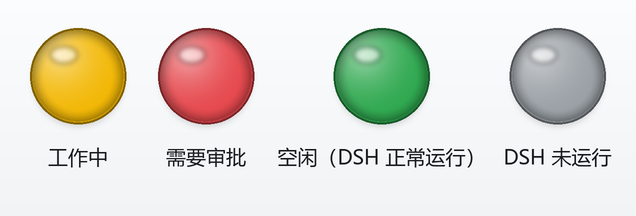

# DSH 状态托盘 · macOS 版

**macOS 菜单栏小工具：一眼看清本机 [DeepSeek Harness（DSH）](https://github.com/deepseek-ai) 是在干活、在等你审批，还是空闲。**

菜单栏右边一个彩色圆点，全程**只读** DSH 的本地数据，不修改、不重启、不调接口：

| 圆点 | 状态 | 含义 | 你该做什么 |
|---|---|---|---|
| 🟡 黄 | **工作中** | DSH 正在跑一个任务（模型思考 / 工具执行中） | 稍等，别关机 |
| 🔴 红 | **需要审批 / 需要你回答** | 有操作在等你拍板，或 DSH 问了你一个问题 | **去处理** |
| 🟢 绿 | **空闲** | DSH 正常运行，没有任务在跑 | 自由安排 |
| ⚪ 灰 | **DSH 未运行** | 本机 DSH 的 Web 服务（默认 `127.0.0.1:3080`）连不上 | 启动 DSH |

优先级：**红灯 > 黄灯 > 绿灯 / 灰灯**。颜色都可以在 `config.json` 里改。



> 非官方社区项目，与 DeepSeek 官方无关。状态判定契约（v1–v6）与 Windows 版完全一致，见 [docs/README.md](docs/README.md)。

---

## 与 Windows 版的差异

| 项目 | Windows 版 | macOS 版 |
|---|---|---|
| 界面 | 任务栏托盘 `NotifyIcon` + `ContextMenuStrip` | 菜单栏 `NSStatusItem` + `NSMenu` |
| 技术栈 | .NET Framework 4.8 / C# WinForms | AppKit / Objective-C（`clang` 编译，无第三方依赖） |
| 左键单击 | 打开控制台 | **默认弹出菜单**（macOS 习惯） |
| 右键单击 | 弹出菜单 | 弹出菜单 |
| 悬浮提示 | 托盘 tooltip（63 字符硬限） | 图标 tooltip（沿用 60 字符预算），另有菜单顶部状态行 |
| 通知 | Windows 通知气泡 | UserNotifications（首次运行需允许）；未授权时回退 `osascript` |
| 提示音 | 系统提示音 / 自定义 `.wav` | `NSBeep` 系统提示音 / 自定义 `.wav`、`.aiff`、`.mp3` |
| 全局快捷键 | Win32 `RegisterHotKey` | Carbon `RegisterEventHotKey`；配置里的 `Win` = `⌘ Command` |
| 开机自启 | 启动文件夹快捷方式 | `~/Library/LaunchAgents/com.dsh.statustray.plist` |
| 运行时目录 | `%LOCALAPPDATA%\DSHStatusTray\` | `~/Library/Application Support/DSHStatusTray/` |
| 单实例 | 命名 Mutex | `tray.lock` 文件锁（`flock`） |

想把左键改回 Windows 的行为（左键单击 = 打开控制台，右键弹菜单），在 `config.json` 里设置：

```json
{ "openConsoleOnLeftClick": true }
```

这是 macOS 专用键，Windows 版会忽略它。

## 系统要求

- **macOS 11 Big Sur 或更高**（Intel / Apple Silicon 均可；构建产物是通用二进制）。
- **Xcode Command Line Tools**（只需 `clang`、`sips`、`iconutil`、`codesign`；缺少时运行 `xcode-select --install` 安装）。不依赖 Swift 工具链。
- **Node.js**：DSH 本身已依赖 Node，通常无需另装。状态引擎用 Node 内置 zstd 解析会话日志；Node 版本过老时仍能显示工作 / 权限状态，只是无法检测「待审批」（会降级提示，不会崩溃）。
- **无需管理员权限**，无需联网（除可选的余额查询）。

## 快速开始

### 1. 构建（只需一次）

```bash
git clone https://github.com/xfhrv/dsh-status-tray.git
cd dsh-status-tray
./build-macos.sh
```

脚本用系统自带的 `clang` 编译 Objective-C 源码，打包成 `bin/DSHStatusTray.app`，并做 ad-hoc 签名（通知权限需要）。
默认尝试 `arm64 + x86_64` 通用二进制；交叉编译不可用时自动回退到本机架构（也可显式 `DSH_MACOS_NATIVE_ONLY=1 ./build-macos.sh`）。

### 2. 运行

```bash
open bin/DSHStatusTray.app
```

菜单栏右边出现一个彩色圆点。**首次运行会请求通知权限**，请点「允许」；否则通知会回退为 `osascript`（显示为「脚本编辑器」的通知）。

> 应用是 `LSUIElement`（仅菜单栏，不占 Dock、不抢焦点），所以「程序坞」里看不到它。要退出请用菜单里的「退出」。

### 3. 开机自启（可选）

```bash
# 安装：写 LaunchAgent，并立即启动托盘
./install-autostart-macos.sh

# 查看状态
./install-autostart-macos.sh --status

# 卸载：取消自启并退出托盘
./install-autostart-macos.sh --remove
```

### 4. 使用

左键单击圆点弹出菜单（右键、⌃+左键同样可以）：

```
状态：工作中 — 侧边栏添加 DeepSeek 快捷入口
权限：工作区内修改 · 第 1 轮第 31 步
────────────────────────────────
打开控制台
打开网页版 DeepSeek
查看 DS 服务器状态
充值余额：¥122.97
────────────────────────────────
设置全局快捷键…
────────────────────────────────
退出                        ⌘Q
```

- 鼠标悬停看 tooltip（多个主会话同时工作时逐行显示）。
- **充值余额**：右键菜单直接显示 DeepSeek 账户余额，点击打开官方充值页；悬停看赠送余额与更新时间。
- **设置全局快捷键…**：录制组合键，效果等同「打开控制台」。macOS 上 `Win` 对应 `⌘`，例如 `Ctrl+Alt+F9` 显示为 `⌃⌥F9`；窗口关闭后立即生效，不会重启托盘。
- 余额查询依赖本机 DSH 已登录凭证与网络，失败只影响余额显示。

## 配置

首次运行会自动生成 `~/Library/Application Support/DSHStatusTray/config.json`：

```json
{
  "consoleUrl": "http://127.0.0.1:3080",
  "pollMs": 500,
  "colors": {
    "approval": "#E5484D",
    "idle": "#2FA84F",
    "offline": "#9AA0A6",
    "working": "#F2B705"
  },
  "hotkey": "",
  "notifyApproval": true,
  "notifyCompletion": true,
  "openConsoleOnLeftClick": false,
  "playSound": true,
  "showBalance": true,
  "soundFile": "",
  "statusUrl": "https://status.deepseek.com/",
  "topUpUrl": "https://platform.deepseek.com/top_up",
  "webChatUrl": "https://chat.deepseek.com/"
}
```

| 键 | 说明 |
|---|---|
| `consoleUrl` | 「打开控制台」打开的地址，也用于判断 DSH 是否在运行（探活该 URL 的端口） |
| `pollMs` | UI 读取与引擎采样周期（毫秒，默认 500，范围 250–10000） |
| `colors` | 四种状态的圆点颜色（`#RRGGBB` 或 `#RGB`），改完重启托盘生效；旧版五色配置会自动迁移 |
| `notifyCompletion` / `notifyApproval` | 分别开关「任务完成」/「需要审批」通知 |
| `playSound` | 通知时是否播放提示音 |
| `soundFile` | 自定义提示音：留空 = 系统提示音；支持绝对路径或相对 app 可执行文件目录的路径（`.wav` / `.aiff` / `.mp3`） |
| `showBalance` | 是否显示「充值余额」菜单项并启用余额查询 |
| `topUpUrl` | 点击余额项打开的正确充值页地址；留空则用 `status.json` 里的 `account.topUpUrl` |
| `webChatUrl` / `statusUrl` | 「打开网页版 DeepSeek」/「查看 DS 服务器状态」打开的地址 |
| `hotkey` | 全局快捷键（如 `Ctrl+Alt+F9`；空字符串 = 未设置）。由设置窗口自动写入，也可手改后重启生效 |
| `openConsoleOnLeftClick` | **macOS 专用**：`true` 时左键单击直接打开控制台（Windows 行为）；默认 `false` 弹菜单 |

## 命令行与自检

```bash
APP=bin/DSHStatusTray.app/Contents/MacOS/DSHStatusTray

# 只跑一次状态引擎，直接打印 status.json（排查用）
node src/status-agent.mjs --once

# 只跑一次并查询账户余额（需要已登录 DSH 账户）
node src/status-agent.mjs --once --account

# 用给定 status.json 静态演示 UI（不启动状态引擎）
"$APP" --no-agent --status /tmp/status.json

# 打印菜单结构后退出（验收用，不弹菜单）
"$APP" --print-menu

# 自动弹出菜单 4 秒后退出（截图验收用）
"$APP" --show-menu --no-agent --status /tmp/status.json

# 导出四色状态图标 PNG 检查颜色
"$APP" --render-icons /tmp/dsh-icons

# 导出应用图标 PNG（构建 .icns 用）
"$APP" --render-app-icon /tmp/AppIcon-1024.png

# 只执行「打开控制台」/「打开充值页」动作后退出
"$APP" --open-console
"$APP" --open-balance

# 只执行「打开网页版 DeepSeek」/「打开 DS 状态页」后退出
"$APP" --open-web
"$APP" --open-status

# 直接打开全局快捷键设置窗口（不启动托盘 / 引擎，验收用）
"$APP" --open-hotkey-settings

# 本次运行临时注册一个全局热键（不写配置，测试用）
"$APP" --hotkey "Ctrl+Alt+F9"

# 手动触发通知（真实弹通知 + 播放提示音，约 6 秒后自动退出）
"$APP" --test-notify completion
"$APP" --test-notify approval
```

一键验收（需先构建）：

```bash
./dev/verify-macos.sh
```

## 工作原理

```
bin/DSHStatusTray.app/Contents/MacOS/DSHStatusTray  (AppKit，菜单栏 UI)
   └─ 隐藏启动 node .../Resources/agent/status-agent.mjs  (状态引擎，常驻)
          ├─ 只读 ~/.dsh/ 下的会话数据
          ├─ 每 500ms 原子写一份 status.json 心跳
          └─ 通过 TCP 探活 127.0.0.1:3080 判断 DSH 是否运行
   └─ 读取 status.json → 画灯 / 弹通知 / 显示余额 / 处理快捷键
```

- 引擎意外退出或卡死时，UI 会自动重启它（≥10 秒退避）。
- 运行时文件都在 `~/Library/Application Support/DSHStatusTray/`：`status.json`（状态快照）、`config.json`、`agent.log`（引擎日志）、`tray.log`（托盘日志）、`tray.lock`（单实例锁）。
- 数据来源（均为**只读**）与 Windows 版相同：`storages/session_projcache/sessions/*.json`、`sessions/**/*.jsonl.zstd`、5 秒一次 TCP 探活。
- 状态引擎脚本随 app 打包在 `Contents/Resources/agent/`，因此把 `.app` 拖到 `/Applications` 也能独立运行。

## 隐私与安全

- **只读**：不修改 DSH 的任何配置、会话或进程，也不调用 DSH 的内部接口。
- **token 不落盘**：可选的余额查询会读取 `~/.dsh/.credentials.yaml` 里的 token，但**只在状态引擎进程内存中使用**，不会写入 `status.json`、日志或任何错误信息，也不会发送到 `platform.deepseek.com` 以外的任何地方。
- **不收集、不上传**：工具本身没有任何遥测；除余额查询外不发起任何网络请求。
- 不想联网查余额？把 `showBalance` 设为 `false` 即可完全离线运行。

## 常见问题

- **菜单栏里找不到圆点？** 菜单栏图标太多时系统会隐藏部分项目；先退出几个菜单栏应用，或在「系统设置 → 控制中心」里精简。确认 `pgrep -fl DSHStatusTray` 有进程，并看 `~/Library/Application Support/DSHStatusTray/tray.log`。
- **全屏应用里看不到图标？** macOS 在全屏时会自动隐藏菜单栏，这是系统行为；把鼠标移到屏幕顶部即可。
- **首次运行没弹通知权限？** 打开「系统设置 → 通知 → DSH 状态托盘」，允许通知；未授权时通知会回退为「脚本编辑器」的 `osascript` 通知。
- **一直是灰灯？** 灰灯 = DSH 未运行（`consoleUrl` 连不上）。若提示「状态监视器未响应」，看 `tray.log` 与 `agent.log`，并确认 `node --version` 可用。
- **红灯一直亮？** 说明确实有一个审批 / 问题还挂着：去 DSH 界面处理，通常 1 秒内变色。
- **没听到提示音？** 检查系统音量 / 静音、`playSound`、`soundFile`；`tray.log` 里会有「播放系统提示音」或「播放提示音: <路径>」记录。
- **任务完成没提示？** 完成通知只对**主会话**的轮次结束触发（被委派的子会话不打扰你），且托盘需在运行中；可用 `--test-notify completion` 自测。
- **余额显示「未登录」/「登录已过期」？** 说明本机 DSH 凭证缺失或失效：在 DSH 里重新登录，最多 10 分钟内自动恢复；余额查询失败不影响状态灯与通知。
- **全局快捷键没生效 / 冲突？** 打开「设置全局快捷键…」，状态行会提示是否注册失败（可能被其他程序或系统占用）。macOS 上 `Ctrl` / `Alt` / `Shift` / `Win`（=`⌘`）至少按一个；`⌘Q`、`⌘Space` 等系统组合通常不可用。录完点「保存并注册」立即生效。
- **用 launchd 启动时找不到 node？** 程序会依次查找 `DSH_TRAY_NODE`、`PATH`、Homebrew / nvm / volta / fnm / asdf 常见路径，最后问一次登录 shell。仍找不到时，在 LaunchAgent plist 里加 `EnvironmentVariables` → `DSH_TRAY_NODE=/绝对路径/node`。
- **从别的 Mac 拷过来的 app 打不开？** 构建产物是 ad-hoc 签名，可能被 Gatekeeper 拦截：右键 →「打开」，或 `xattr -dr com.apple.quarantine bin/DSHStatusTray.app`。
- **怎么完全退出？** 菜单 →「退出」；或 `./install-autostart-macos.sh --remove`。SIGTERM（如 `launchctl bootout`）也会清理内部 node 子进程；`kill -9` 可能留下 node 子进程（不影响 DSH，下次启动会自动接管）。
- **会拖慢 DSH 吗？** 不会：只读少量文件、增量解析、空闲时每 500ms 的开销在毫秒级，且不写 DSH 的任何数据。

## 目录结构（macOS 相关）

```
dsh-status-tray/
├─ src/
│  ├─ TrayApp.cs                # Windows 托盘 UI
│  ├─ status-agent.mjs          # 状态引擎（跨平台，macOS 目录已适配）
│  ├─ status-core.mjs           # 纯状态计算
│  └─ macos/
│     ├─ main.m                 # 入口：参数 / 单实例 / 调试模式
│     ├─ DSHCommon.h            # 共享声明
│     ├─ DSHConfig.m            # 路径 / 日志 / config.json / status.json
│     ├─ DSHAgent.m             # node 定位 + 子进程守护
│     ├─ DSHIcon.m              # 菜单栏圆点 / 应用图标绘制
│     ├─ DSHHotkey.m            # 全局快捷键 + 设置窗口
│     ├─ DSHTray.m              # 菜单栏图标 / 菜单 / 通知 / 轮询
│     └─ Info.plist             # LSUIElement / bundle id / 版本
├─ build-macos.sh               # 一键编译 + 打包 .app + ad-hoc 签名
├─ install-autostart-macos.sh   # LaunchAgent 安装 / 卸载 / 状态
├─ dev/verify-macos.sh          # macOS 一键验收
└─ test/platform.test.mjs       # 跨平台运行时目录测试
```

## 开发与测试

```bash
# 单元测试（状态判定 / 日志增量 / 审批检测 / 通知事件 / 余额查询 / 平台路径）
npm test

# 构建（macOS）
npm run build:mac

# 验收
npm run verify:mac
```

macOS 的 UI 层没有单元测试框架依赖；验收路径是 `--print-menu`、`--render-icons`、`--test-notify`、`./dev/verify-macos.sh` 与手工截图，和 Windows 版的 `--test-notify` 思路一致。

## 已知限制与取舍

- 状态来自 DSH 的**本地落盘数据**，属于旁路观察而非官方 API；DSH 版本差异可能导致个别字段缺失（此时显示为未知 / 灰灯，不会崩溃）。
- 多会话并存时，审批 / 工作中状态取所有近期会话的聚合优先级。
- 通知去重只在托盘进程内保持：重启托盘后，同一个「已完成」不会重播，但启动时已挂起的审批会再提示一次。
- tooltip 仍按 60 字符预算（与 Windows 契约一致）；macOS 上信息更多靠菜单顶部状态行展示。
- 通知权限被拒绝时会回退到 `osascript`，通知来源显示为「脚本编辑器」，且系统可能把它折叠进通知中心。
- 全局快捷键是系统级注册：可能被其它程序占用（设置窗口会提示注册失败）；个别全屏 / 远程桌面场景下也可能不生效（macOS 系统限制）。
- `--open-hotkey-settings` 是独立进程，和正在运行的托盘同时使用时，同一个热键会被占用；正式使用请从菜单打开设置窗口。
- 应用未做公证（notarization）；分发到其他 Mac 需要右键打开或自行签名。

## English

**DSH Status Tray (macOS)** is a menu-bar indicator for [DeepSeek Harness (DSH)](https://github.com/deepseek-ai). It watches DSH's local session files (read-only) and shows a colored dot: 🟡 working, 🔴 needs approval/answer, 🟢 idle, ⚪ offline. Menu-bar menu, multi-session tooltip, completion/approval notifications with sound, account balance, quick links, and a configurable global hotkey.

Build with `./build-macos.sh`, run with `open bin/DSHStatusTray.app`. Requires macOS 11+, Xcode Command Line Tools, and Node.js (already required by DSH). Native AppKit/Objective-C, zero third-party dependencies. See [docs/README.md](docs/README.md) for the shared state contracts.

Not an official DeepSeek project. Licensed under MIT.
