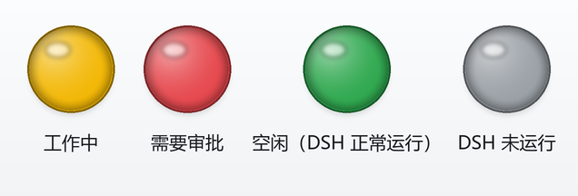
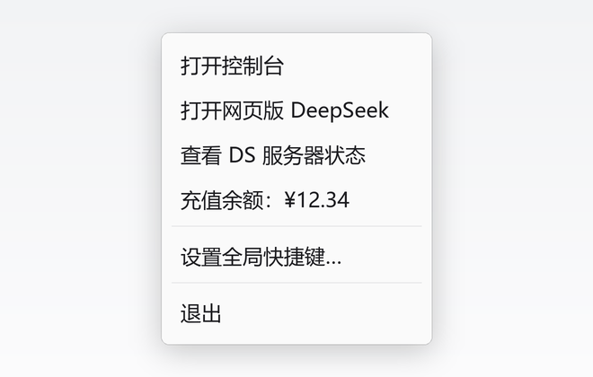
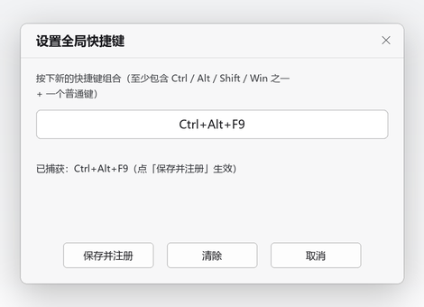
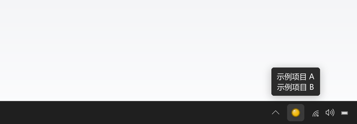
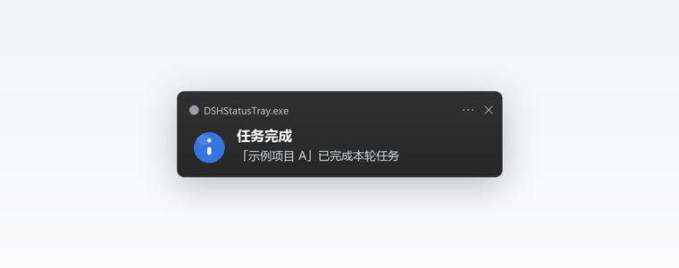
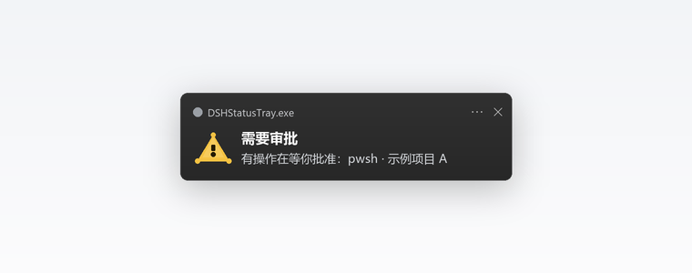

# DSH 状态托盘 · DSH Status Tray

**Windows 任务栏托盘小工具：一眼看清本机 [DeepSeek Harness（DSH）](https://github.com/deepseek-ai)当前离线在干什么——是在干活，还是在等你。**




> 非官方社区项目，与 DeepSeek 官方无关。

---

## 它解决什么问题

用 DSH 跑一个长任务时，你通常会在别的窗口里干活。想确认它是否还在跑、是不是卡在等审批，就得到处找窗口。

这个工具在系统托盘里放一个**彩色圆点**，全程**只读** DSH 的本地数据，不修改、不重启、不调接口：

| 圆点 | 状态 | 含义 | 你该做什么 |
|---|---|---|---|
| 🟡 黄 | **工作中** | DSH 正在跑一个任务（模型思考 / 工具执行中） | 稍等，别关机 |
| 🔴 红 | **需要审批 / 需要你回答** | 有操作在等你拍板，或 DSH 问了你一个问题 | **去处理** |
| 🟢 绿 | **空闲** | DSH 正常运行，没有任务在跑 | 自由安排 |
| ⚪ 灰 | **DSH 未运行** | 本机 DSH 的 Web 服务（默认 `127.0.0.1:3080`）连不上 | 启动 DSH |

优先级：**红灯 > 黄灯 > 绿灯 / 灰灯**。颜色都可以在 `config.json` 里改。

## 功能特性

- **四色状态灯**：工作中 / 需要审批 / 空闲 / DSH 未运行，300ms 级的实时反馈。
- **多会话悬停提示**：鼠标移上去，逐个列出所有正在工作的主会话标题（自动适配 Windows 托盘提示 63 字符上限）。
- **桌面通知 + 提示音**：任务完成、有操作需要审批时弹 Windows 通知气泡；默认用系统提示音，也可指定自己的 `.wav`。
- **充值余额菜单**：右键直接显示 DeepSeek 账户充值余额，点击打开官方充值页。
- **快捷入口 + 全局快捷键**：右键一键打开网页版 DeepSeek / DS 服务器状态；可录制系统全局热键，效果等同左键单击托盘图标（打开 DSH 控制台）。
- **零第三方依赖**：托盘用 .NET Framework 4.8 + C# WinForms，状态引擎是纯 Node 脚本，不装任何 npm 包。
- **开机自启可选**：一条命令安装 / 卸载，无需管理员权限。
- **隐私友好**：不联网上报、不写 DSH 数据；账户 token 只在内存里用一次。

## 界面

托盘右键菜单：



菜单 →「设置全局快捷键…」录制系统热键（效果等同左键单击托盘图标）：



多个主会话同时工作时，悬停提示逐行显示：



任务完成 / 需要审批时的 Windows 通知：

<p>
  
  
</p>

> 以上为界面示意图，用于说明布局与文案；实际外观随 Windows 版本与主题略有差异。

## 系统要求

- **Windows 10 / 11**（依赖系统自带的 .NET Framework 4.8，无需额外安装）
- **Node.js**：DSH 本身已依赖 Node，通常无需另装。状态引擎用 Node 内置的 zstd 解析会话日志；Node 版本过老时仍可显示工作 / 权限状态，只是无法检测「待审批」（会降级提示，不会崩溃）。
- **无需管理员权限**，无需联网（除可选的余额查询）。

## 快速开始

### 1. 构建（只需一次）

```powershell
git clone https://github.com/xfhrv/dsh-status-tray.git
cd dsh-status-tray
powershell -ExecutionPolicy Bypass -File build.ps1
```

脚本用系统自带的 `csc.exe`（.NET Framework 4.x）编译，输出 `bin\DSHStatusTray.exe`。

### 2. 运行

双击 `bin\DSHStatusTray.exe`，托盘出现一个圆点。

> 首次可能被 Windows 收进任务栏的「显示隐藏的图标 ^」里，把它拖到任务栏上即可常驻。

### 3. 开机自启（可选）

```powershell
# 安装：在「启动」文件夹创建快捷方式，并立即启动托盘
powershell -ExecutionPolicy Bypass -File install-autostart.ps1

# 卸载
powershell -ExecutionPolicy Bypass -File install-autostart.ps1 -Remove
```

### 4. 使用

- 看圆点颜色判断状态；鼠标悬停看具体在跑哪个会话。
- 右键菜单：
  - **打开控制台**：打开 DSH Web 界面（默认 `http://127.0.0.1:3080`）
  - **打开网页版 DeepSeek**：打开 `https://chat.deepseek.com/`
  - **查看 DS 服务器状态**：打开 `https://status.deepseek.com/`
  - **充值余额：¥xx.xx**：显示账户充值余额，点击打开官方充值页
  - **设置全局快捷键…**：录制 / 修改系统全局热键（功能 = 打开控制台）
  - **退出**
- **左键单击圆点 = 打开控制台**（与全局快捷键相同）；双击也只打开一次（内置 0.6 秒去抖，不会开两个标签页）。

## 配置

首次运行会自动生成 `%LOCALAPPDATA%\DSHStatusTray\config.json`：

```json
{
  "consoleUrl": "http://127.0.0.1:3080",
  "pollMs": 500,
  "colors": {
    "approval": "#E5484D",
    "working": "#F2B705",
    "idle": "#2FA84F",
    "offline": "#9AA0A6"
  },
  "notifyCompletion": true,
  "notifyApproval": true,
  "playSound": true,
  "soundFile": "",
  "showBalance": true,
  "topUpUrl": "https://platform.deepseek.com/top_up",
  "webChatUrl": "https://chat.deepseek.com/",
  "statusUrl": "https://status.deepseek.com/",
  "hotkey": ""
}
```

| 键 | 说明 |
|---|---|
| `consoleUrl` | 右键「打开控制台」打开的地址，也用于 TCP 探活判断 DSH 是否在运行 |
| `pollMs` | UI 读取与引擎采样周期（毫秒，默认 500，最小 250） |
| `colors` | 四种状态的圆点颜色（`#RRGGBB`），改完重启托盘生效；旧版五色配置会自动迁移 |
| `notifyCompletion` / `notifyApproval` | 分别开关「任务完成」/「需要审批」通知 |
| `playSound` | 通知时是否播放提示音 |
| `soundFile` | 自定义提示音 wav：留空 = 系统提示音；支持绝对路径或相对 exe 目录的路径；文件不存在时回退系统提示音 |
| `showBalance` | 是否显示「充值余额」菜单项并启用余额查询 |
| `topUpUrl` | 点击余额项打开的充值页地址 |
| `webChatUrl` / `statusUrl` | 「打开网页版 DeepSeek」/「查看 DS 服务器状态」打开的地址 |
| `hotkey` | 全局快捷键（如 `Ctrl+Alt+F9`；空字符串 = 未设置）。由「设置全局快捷键…」窗口自动写入，也可手改后重启生效 |

## 工作原理

```
DSHStatusTray.exe  (C# WinForms，托盘 UI)
   └─ 隐藏启动 node.exe src\status-agent.mjs  (状态引擎，常驻)
          ├─ 只读 %USERPROFILE%\.dsh\ 下的会话数据
          ├─ 每 500ms 原子写一份 status.json 心跳
          └─ 通过 TCP 探活 127.0.0.1:3080 判断 DSH 是否运行
   └─ 读取 status.json → 画灯 / 弹通知 / 显示余额
```

- 引擎意外退出或卡死时，UI 会自动重启它；找不到 Node 时托底显示灰灯并提示。
- 运行时文件都在 `%LOCALAPPDATA%\DSHStatusTray\`：`status.json`（状态快照）、`config.json`、`agent.log`（引擎日志）、`tray.log`（托盘异常日志）。

数据来源（均为**只读**）：

- `storages\session_projcache\sessions\*.json` —— DSH 的会话投影缓存（JSON），判断是否有未结束的轮次 / 步骤、是否有待回答的问题、会话标题；
- `sessions\**\session.v*.jsonl.zstd` —— 会话事件日志（多 zstd frame 追加），引擎**增量**读取尾部，检测 `approval/asked`（未决审批）与 `approval/decided`（已决），所以审批挂多久红灯就亮多久；
- 每 5 秒对 `127.0.0.1:3080` 做一次 TCP 探活，判断 DSH 是否在运行。

## 隐私与安全

- **只读**：不修改 DSH 的任何配置、会话或进程，也不调用 DSH 的内部接口。
- **token 不落盘**：可选的余额查询会读取本机 DSH 已登录的账户凭证（`%USERPROFILE%\.dsh\.credentials.yaml`）里的 token，但**只在状态引擎进程内存中使用**，不会写入 `status.json`、日志或任何错误信息，也不会发送到 `platform.deepseek.com` 以外的任何地方。
- **不收集、不上传**：工具本身没有任何遥测；除余额查询外不发起任何网络请求。
- 不想联网查余额？把 `showBalance` 设为 `false` 即可完全离线运行。

## 命令行与自检

```powershell
# 只跑一次状态引擎，直接打印 status.json（排查用）
node src\status-agent.mjs --once

# 只跑一次并查询账户余额（需要已登录 DSH 账户）
node src\status-agent.mjs --once --account

# 用给定的 status.json 静态演示 UI（不启动状态引擎）
bin\DSHStatusTray.exe --no-agent --status C:\path\to\status.json

# 导出状态图标 PNG 检查颜色
bin\DSHStatusTray.exe --render-icons %TEMP%\dsh-icons

# 只执行「打开控制台」/「打开充值页」动作后退出
bin\DSHStatusTray.exe --open-console
bin\DSHStatusTray.exe --open-balance

# 只执行「打开网页版 DeepSeek」/「打开 DS 服务器状态」后退出
bin\DSHStatusTray.exe --open-web
bin\DSHStatusTray.exe --open-status

# 直接打开全局快捷键设置窗口（不启动托盘 / 引擎，验收用）
bin\DSHStatusTray.exe --open-hotkey-settings

# 本次运行临时注册一个全局热键（不写配置，测试用）
bin\DSHStatusTray.exe --hotkey "Ctrl+Alt+F9"

# 手动触发通知（真实弹气泡 + 播放提示音，5 秒后自动退出）
bin\DSHStatusTray.exe --test-notify completion
bin\DSHStatusTray.exe --test-notify approval
```

## 常见问题

- **托盘里找不到圆点？** 点任务栏的「显示隐藏的图标」（^），把圆点拖到任务栏；或检查任务管理器里是否有 `DSHStatusTray.exe`。
- **一直是灰灯？** 灰灯 = DSH 未运行（`consoleUrl` 连不上）。若提示「状态监视器未响应」，看 `%LOCALAPPDATA%\DSHStatusTray\agent.log` 与 `tray.log`，并确认 `node --version` 可用。
- **红灯一直亮？** 说明确实有一个审批 / 问题还挂着：去 DSH 界面处理，通常 1 秒内变色。
- **没听到提示音？** 检查系统音量 / 静音、`playSound`、`soundFile`；`tray.log` 里会有「播放提示音: `<路径>`」或「播放系统提示音」记录。
- **看不到气泡？** 检查 Windows「通知」设置是否允许 `DSHStatusTray.exe`，以及是否开了勿扰 / 专注助手。气泡被系统屏蔽时，变色与提示音仍然生效。
- **任务完成没提示？** 完成通知只对**主会话**的轮次结束触发（被委派的子会话不打扰你），且托盘需在运行中。可用 `--test-notify completion` 自测。
- **余额显示「未登录」/「登录已过期」？** 说明本机 DSH 凭证缺失或失效：在 DSH 里重新登录，最多 10 分钟内自动恢复（重启托盘可立即刷新）。余额查询失败不影响状态灯与通知。
- **左键单击没反应？** 左键单击 = 打开控制台（与全局快捷键相同）。若仍无反应，看 `%LOCALAPPDATA%\DSHStatusTray\tray.log` 是否有「托盘左键单击」记录。
- **全局快捷键没生效 / 冲突？** 打开「设置全局快捷键…」，状态行会提示是否注册失败（可能被其他程序占用）；换一个组合（如 `Ctrl+Alt+F8`）再保存即可。录制时至少按一个修饰键 + 一个普通键，设置成功后重启托盘仍会保留。
- **会拖慢 DSH 吗？** 不会：只读少量文件、增量解析、空闲时每 500ms 的开销在毫秒级，且不写 DSH 的任何数据。
- **怎么完全退出？** 右键 →「退出」。建议用菜单退出；若在任务管理器里强制结束，内部 node 子进程可能残留（不影响 DSH，下次启动会自动复用 / 接管）。

## 目录结构

```
dsh-status-tray/
├─ src/
│  ├─ TrayApp.cs                # 托盘 UI（C# 5 / WinForms，单文件）
│  ├─ app.manifest              # DPI aware
│  ├─ status-agent.mjs          # 状态引擎（Node，常驻，由 exe 隐藏拉起）
│  └─ status-core.mjs           # 纯状态计算（可单测）
├─ test/
│  └─ status.test.mjs           # node --test 单元测试
├─ dev/                         # 开发辅助脚本（基准、体检、降级验证、文档配图生成）
├─ docs/                        # 设计契约（v1–v6）与界面示意图
├─ build.ps1                    # 一键编译（系统自带 csc.exe）
├─ install-autostart.ps1        # 开机自启安装 / 卸载
└─ package.json                 # npm test / build 快捷入口
```

## 开发与测试

```powershell
# 单元测试（状态判定 / 日志增量 / 审批检测 / 通知事件 / 余额查询等）
npm test          # 等价于 node --test

# 编译
npm run build     # 等价于 powershell -ExecutionPolicy Bypass -File build.ps1
```

- `dev/bench.mjs`：测常驻模式下单次轮询耗时；
- `dev/inspect.mjs`、`dev/scan-log.mjs`：体检 DSH 本地数据结构与日志；
- `dev/check-degraded.mjs`：验证旧版 Node 缺少 zstd 时的优雅降级；
- `dev/render-docs-images.py`：重新生成 `docs/` 下的界面示意图（需要 Python 3 + Pillow，仅维护者使用）。

## 设计文档

实现契约按版本增量演进，细节见 **[docs/README.md](docs/README.md)**：

| 版本 | 内容 |
|---|---|
| v1 [status-schema.md](docs/status-schema.md) | 状态判定、数据源、`status.json` / `config.json`、进程模型 |
| v2 [alerts-spec.md](docs/alerts-spec.md) | 任务完成 / 审批通知与提示音 |
| v3 [account-balance-spec.md](docs/account-balance-spec.md) | 充值余额菜单 |
| v4 [working-sessions-spec.md](docs/working-sessions-spec.md) | 多会话悬停提示 |
| v5 [state-model-v5.md](docs/state-model-v5.md) | 四态状态模型与菜单精简 |
| v6 [menu-hotkey-v6.md](docs/menu-hotkey-v6.md) | 网页版 / 状态页快捷入口、全局快捷键、左键单击打开控制台 |

## 已知限制与取舍

- 状态来自 DSH 的**本地落盘数据**，属于旁路观察而非官方 API；DSH 版本差异可能导致个别字段缺失（此时显示为未知 / 灰灯，不会崩溃）。
- 多会话并存时，审批 / 工作中状态取所有近期会话的聚合优先级。
- 通知去重只在托盘进程内保持：重启托盘后，同一个「已完成」不会重播，但启动时已挂起的审批会再提示一次。
- 同一时刻多条完成 / 审批事件只提示最新一条（两次完成间隔小于采样周期时可能合并）。
- Windows 托盘提示有 **63 字符**硬上限，本工具按 60 字符预算排布；会话太多 / 标题太长时会省略并显示 `…等 N 个会话`。
- 余额查询依赖本机 DSH 凭证与网络，结果最多缓存约 10 分钟；失败只影响余额显示。
- 全局快捷键是系统级注册：可能被其它程序的同名热键占用（设置窗口会提示注册失败），在个别全屏游戏 / 远程桌面场景下也可能不生效（Windows 系统限制）。

## 许可证

[MIT](LICENSE)

---

## English

**DSH Status Tray** is a small Windows system-tray indicator for [DeepSeek Harness (DSH)](https://github.com/deepseek-ai). It watches DSH's local session files (read-only) and shows a colored dot:

- 🟡 **working** — DSH is running a task
- 🔴 **needs approval / answer** — DSH is waiting on you
- 🟢 **idle** — DSH is running but has nothing to do
- ⚪ **offline** — DSH's local web service is not reachable

It also provides multi-session hover tooltips, completion/approval toast notifications with sound, an optional account-balance menu item, quick links to the DeepSeek web app and status page, and a configurable system-wide hotkey that opens the local DSH console (same as left-clicking the tray dot). Zero third-party dependencies: the tray is C# WinForms on .NET Framework 4.8, the status engine is a plain Node script.

Build with `powershell -ExecutionPolicy Bypass -File build.ps1`, then run `bin\DSHStatusTray.exe`. Requires Windows 10/11 and Node.js (already required by DSH). See **[docs/README.md](docs/README.md)** for the design contracts.

Not an official DeepSeek project. Licensed under MIT.
